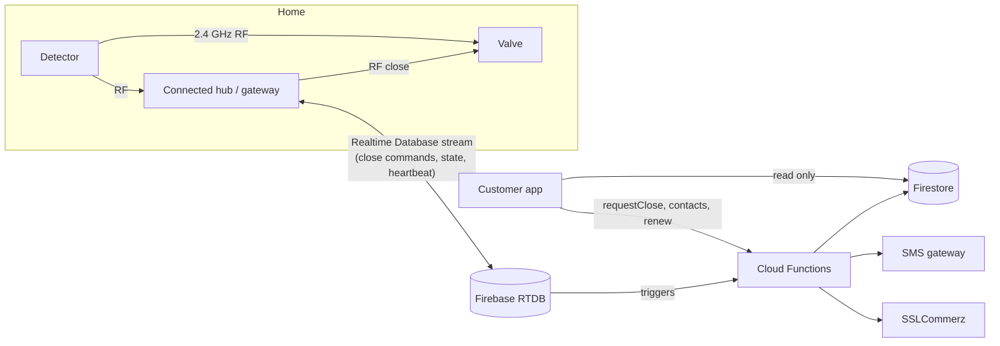

# VenGuard Connected: cloud backend

The customer side of the **Connected plan (BDT 550/year)** from the VenGuard HCD v4:
remote valve close from a phone, a live dashboard, SMS alerts to family, and multi-unit monitoring
for landlords. The customer app is `VENGuard/app/` (source: `src/app/app.html`).

**Safety rules built into every part:** the cloud is never in the safety loop; the only remote
command is *close*; reopening is the lever at the stove; "closed" is shown only after the device confirms.

## How it fits together



| Piece | What it does |
|---|---|
| `functions/index.js` | Device sign-in, state/event/ack mirrors, `requestClose`, `claimDevice`, `saveContacts`, plan renewal (SSLCommerz) and its payment notification, presence sweep, SMS alerts |
| `database.rules.json` | A device can only read its own commands and write its own state, events, acks and heartbeat. Nobody can write a command |
| `firestore.rules` | Customers can read only their own homes, devices, events and commands, and can write none of them |
| `DEVICE_API.md` | The contract for firmware |
| `functions/tools/provision.js` | Factory tool: device secret to flash + sticker code |
| `functions/test/` | Unit tests and an end-to-end emulator test that plays both the device and the customer |

## Set up (about 1 hour, once)

1. Create a Firebase project **in the company's Google account** (e.g. `venguard-connected`) and switch
   it to the **Blaze** (pay-as-you-go) plan, which Cloud Functions need. Set a **budget alert** (e.g. US$30/month).
2. **Build → Authentication → Sign-in method → Phone**: enable. Add `oasisnextbd.github.io` (and the
   future domain) under **Settings → Authorized domains**.
3. **Firestore**: create in `asia-southeast1` (Singapore). **Realtime Database**: create in `asia-southeast1`.
4. **Project settings → Your apps → Web app**: register "VenGuard app"; copy the `firebaseConfig`
   object into `VENGuard/src/site.json` → `connected.firebase`, run `python3 src/build.py`, commit, push.
   The app at `/VENGuard/app/` switches from demo to live.
5. On a computer with Node 20: `npm i -g firebase-tools`, `firebase login`, then in this folder:
   ```
   firebase use --add            # pick the project
   firebase functions:secrets:set DEVICE_MASTER_KEY     # 64 random characters; keep a copy in the password manager
   firebase functions:secrets:set SMS_API_URL           # your SMS gateway (optional at first)
   firebase functions:secrets:set SMS_API_KEY
   firebase functions:secrets:set SMS_SENDER_ID
   firebase functions:secrets:set SSLC_STORE_ID         # when the SSLCommerz account is live
   firebase functions:secrets:set SSLC_STORE_PASSWORD
   cd functions && npm install && npm test && cd ..
   firebase deploy --only functions,firestore,database
   ```
6. Generate device secrets and sticker codes with `functions/tools/provision.js` during flashing.

## Test without hardware

```
cd functions && npm install && npm test && npm run test:e2e
```
`test:e2e` starts the local emulators (Java needed) and checks: device sign-in with the right and the
wrong key, state reaching the app, database rules refusing bad or cross-device writes, close requests
only from household members, commands that can't be forged, "closed" only after the device's ack,
leak events, and that customers can only read their own data.

The app also has a demo mode (no backend configured) with simulated kitchens, a leak and an offline
device: open `/VENGuard/app/`.

## What it costs to run (estimate, check with the Firebase pricing calculator)

- Each device: one open database connection, a ~100-byte heartbeat a minute, state writes only on change.
  No polling, so database reads/writes and function calls stay roughly proportional to *events*, not to time.
- This design aims to fit the HCD model's BDT 5 per subscriber per month for cloud + SMS. It has not
  been measured yet: check the real bill after the first 100 devices, and again at 1,000. SMS is
  likely to be the larger part.
- Realtime Database allows 200,000 simultaneous connections per database; shard beyond that.

## Not built yet

- **Push notifications** (Firebase Cloud Messaging + a service worker). SMS covers alerts for now.
- **Inviting family members** to see a home in the app (today: the owner's account; alerts go by SMS to up to 3 people).
- **Landlord onboarding** of many flats at once (today: support creates the building and pairs units).
- **Team-side support view** (search a device, move it to another account): add to the team dashboard.
- **Wi-Fi setup flow** for the hub (depends on the hardware choice in `DEVICE_API.md` §1).
